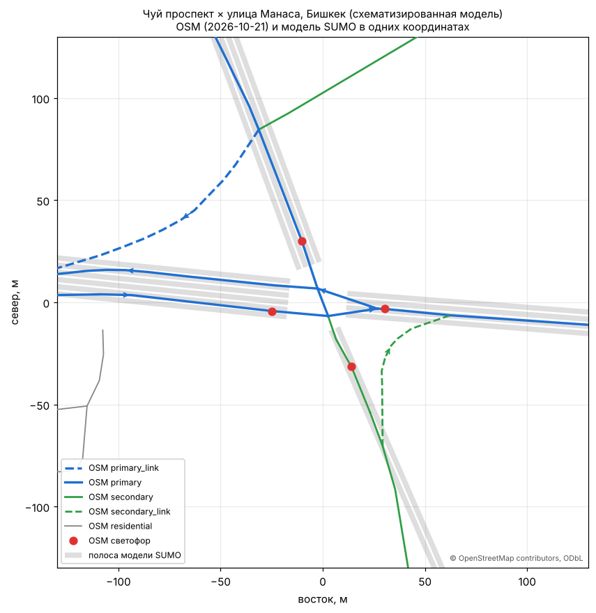

# Эксперимент 1: перекрёсток Чуй × Манаса в SUMO

Первый инженерный эксперимент SmartFlow AI. Один перекрёсток Бишкека моделируется в [SUMO](https://eclipse.dev/sumo/) 1.28.0, светофором управляет Python через TraCI. Сравниваются два контроллера, фиксированный цикл и адаптивный по очередям и ожиданию, на одних и тех же маршрутах при трёх уровнях нагрузки и трёх seed.

**Что это не такое.** Это не копия реального перекрёстка и не прогноз для него. Геометрия схематизирована, спрос синтетический, план фаз инженерный (программы реального светофора в открытых данных нет). Результат — сравнение двух алгоритмов **внутри этой модели**. Адаптивный контроллер основан на правилах, машинного обучения в нём нет.

Браузер ничего не моделирует. Страница `#sumo` проигрывает кадры, записанные во время настоящего прогона SUMO, и показывает сводку из `results.json`.

## Результаты коротко

18 прогонов SUMO 1.28.0: 3 нагрузки × 3 seed × 2 контроллера, в каждом 60 минут спроса. Посчитано 21.10.2026, весь эксперимент занимает около 7 минут.

- **Безопасность:** 0 столкновений, 0 шагов с конфликтующими зелёными, 0 телепортаций. Все поездки завершены. Самые короткие зелёный, жёлтый и «все красные», которые были в SUMO, — 8, 3 и 2 с.
- **Ожидание:** адаптивный контроллер снизил среднее ожидание на поездку на 49 % при низкой нагрузке, на 40 % при средней и на 57 % при высокой.
- Самое честное сравнение — при средней нагрузке: на неё рассчитан фиксированный цикл. Там ожидание снизилось с 34,2 до 20,6 с.
- **Тесты:** 28 на Python (14 без SUMO, 14 с SUMO) и 7 на TypeScript (данные для веба): все проходят.

Это результат для схематизированной модели с синтетическим спросом и идеальными датчиками (см. «Ограничения»), а не обещание для реального перекрёстка.

## Архитектура

```
sumo/
  scenario/chui-manas.json      описание перекрёстка: факты OSM и допущения, у параметров указан источник
  scenario/osm/*.json           сохранённые ответы Overpass API (факты OSM на дату запроса)
  tools/osm_probe.py            сбор фактов из OSM (нужен интернет; в прогонах не участвует)
  smartflow_sumo/
    build.py                    сценарий → plain XML → netconvert → сеть SUMO; план фаз из матрицы конфликтов; спрос
    control.py                  алгоритмы управления и страж безопасности: чистый Python, без SUMO и без веба
    run.py                      один прогон: SUMO + TraCI, датчики, независимые проверки безопасности, метрики
    trace.py                    запись кадров для веба (формат smartflow-sumo-trace/1) и её проверка
    experiment.py               полный эксперимент: нагрузки × seed × контроллеры → public/data/sumo/
  tests/test_control.py         14 тестов алгоритмов, SUMO не нужен
  tests/test_sumo.py            14 тестов с настоящим SUMO
src/sumo/trace.ts               типы и проверка формата на стороне веба, интерполяция между кадрами
src/sumo/SumoApp.tsx            страница #sumo: проигрывание записи и таблицы, без модели
tests/sumoTrace.test.ts         проверка закоммиченных данных и отклонение битых файлов
```

Поток данных в одном шаге моделирования (1 с):

```
SUMO ──TraCI──▶ run.py: датчики → Observation(очереди, ожидание, подъезжающие)
                        │
                        ▼
              control.py: контроллер.request(фаза, время зелёного, наблюдение) → «хочу фазу k» или None
                        │
                        ▼
              control.py: SignalSupervisor.step() — решает сам: мин. зелёный, жёлтый, «все красные»
                        │
                        ▼
SUMO ◀──TraCI── setRedYellowGreenState(строка состояния)
                        │
run.py: независимо читает сигнал из SUMO и проверяет его по матрице конфликтов; считает столкновения и телепортации
                        │
trace.py / experiment.py ──▶ public/data/sumo/*.json ──▶ браузер (только чтение)
```

`control.py` не импортирует ни TraCI, ни что-либо из веба. Контроллер не может включить сигнал напрямую: он только просит фазу, а переход делает страж. TraCI есть только в `run.py`, веб читает только JSON.

## Модель перекрёстка: что из OSM, что допущено

Факты получены через Overpass API (`tools/osm_probe.py`) 21.10.2026 и сохранены в `scenario/osm/`: общие узлы и теги линий (`chui-manas.probe.json`), вся дорожная геометрия в радиусе 160 м (`chui-manas.geometry.json`), запреты поворотов (`chui-manas.restrictions.json`).



Картинка строится скриптом `tools/plot_osm_vs_model.py`: линии OSM (цвет — класс дороги, стрелки — односторонние) и полосы сети SUMO (серые) в одних локальных метрах. По ней видно, что модель совпадает с OSM по направлениям и числу полос, но упрощает сам узел: в реальности проспект Чуй разделён на две проезжие части, к востоку они сходятся в одну дорогу, правые повороты с Манаса идут по съездам, а стоп-линии (светофоры) стоят в 25–35 м от центра.

| Параметр | В модели | Источник |
|---|---|---|
| Положение | 42,877856° с. ш., 74,562291° в. д. | OSM: общие узлы линий проспекта Чуй и улицы Манаса |
| Регулирование | светофор | OSM: 4 узла `highway=traffic_signals` в 25–35 м от центра |
| Азимуты подходов | С 339,7°, Ю 156,5°, В 94,4°, З 275,7° (Манаса пересекает Чуй под углом ≈ 65°) | OSM: геометрия линий |
| Полосы на въезд / выезд | Чуй с запада 3 / 3, Чуй с востока 2 / 2, Манаса с севера 2 / 2, Манаса с юга 1 / 1 | OSM: `lanes`, `oneway`, `highway` (к югу Манаса — secondary на 2 полосы) |
| Скорость | 60 км/ч | OSM: `maxspeed` |
| Запреты поворотов | с юга направо — запрещено | OSM: отношение 2700742 `no_right_turn` |
| Правый поворот с севера | идёт по съезду, не через светофор | вывод по геометрии: съезд 22775514 (`primary_link`), запрета в OSM нет |
| Назначение полос | Чуй с запада: налево / прямо / прямо+направо; с востока: налево+прямо / прямо+направо; Манаса с севера: налево / прямо; с юга: налево+прямо | допущение: `turn:lanes` в OSM нет |
| Развороты | запрещены | допущение |
| Длина подходов | 220 м, прямые | допущение |
| Зона перекрёстка | ≈ 25 × 25 м (строит `netconvert`) | упрощение: в реальности ≈ 55 × 60 м |
| Разделительная полоса, съезды, соседние примыкания, бордюры | нет | упрощение |
| Пешеходы, автобусы, парковка | нет | упрощение |

**Запреты поворотов из OSM.** В радиусе 80 м от центра в OSM два отношения `type=restriction`. Оба разобраны в сценарии (`osm_restrictions`), тест `test_osm_turn_restrictions_respected` проверяет, что каждое отношение из сохранённого ответа OSM учтено и что запрещённого соединения в сети нет:

- 2700742 `no_right_turn`: с улицы Манаса с юга направо, на проспект Чуй на восток. В модели этого манёвра нет; в реальности для него есть съезд 200985131 в обход светофора;
- 17994656 `only_straight_on`: узел в 59 м к югу, примыкание съезда. В схеме одного узла его нет, выезд на юг в модели и так только прямо.

**Первая версия сценария была неточной.** Сначала модель строилась только по линиям, проходящим через центральный узел. В ней у Манаса с юга было 2 полосы в каждую сторону, у Чуй с востока — 3, а правые повороты с Манаса шли через светофор. Наложение на полную геометрию OSM и запрос запретов поворотов это исправили. Все результаты ниже получены на исправленной модели.

## Проверки геометрии, поворотов и фаз

Тесты `tests/test_sumo.py` собирают сеть через `netconvert` и проверяют результат, а не исходное описание:

- у каждого подхода столько входных и выходных полос, сколько в сценарии;
- азимут каждого подхода в сети SUMO совпадает с азимутом улицы в OSM с точностью 2°;
- множество разрешённых соединений «полоса → выезд» в сети **в точности** равно разметке из сценария, разворотов нет;
- матрица конфликтов узла (`<request foes>`, её строит SUMO) согласуется со здравым смыслом: пересекающиеся прямые конфликтуют, левый поворот конфликтует со встречным прямым, встречные прямые не конфликтуют;
- выбранный план фаз не даёт зелёный двум конфликтующим связям ни в одной фазе и обслуживает все связи.

План фаз строится автоматически (`build.candidate_plans`) и принимается только после проверки по матрице конфликтов SUMO (`SignalPlan`). Для этой разметки получился план из 4 фаз, по одной на подход: с севера, с юга, с востока, с запада. Генератор пробует и защищённый левый на оси (две фазы: «прямо + направо» обеих сторон, затем «налево» обеих сторон), но он возможен, только если у обоих встречных подходов есть отдельная левая полоса. Здесь на юге и востоке левый поворот идёт из общей полосы «налево + прямо», и без конфликтующих зелёных его можно обслужить только раздельной фазой подхода.

На реальных светофорах часто разрешён левый поворот «на зелёный с уступкой встречным». Здесь такие разрешения намеренно не используются: по условию эксперимента одновременно зелёные конфликтующие связи запрещены. Раздельные фазы снижают пропускную способность обоих контроллеров.

## Безопасность переключения

`SignalSupervisor` (конечный автомат в `control.py`) общий для обоих контроллеров:

- переход только по цепочке зелёный → жёлтый 3 с → «все красные» 2 с → следующий зелёный;
- минимальный зелёный 8 с: просьбу сменить фазу раньше страж откладывает;
- жёсткий максимум зелёного 120 с, даже если контроллер просит продлить;
- нельзя настроить жёлтый короче 3 с или «все красные» короче 1 с (`UnsafePlanError`).

Во время прогона `run.py` на каждом шаге **независимо** читает из SUMO фактическую строку сигнала и проверяет её по матрице конфликтов, а также считает столкновения (`--collision.check-junctions`) и телепортации (застрявшие машины, порог 300 с). Тест `test_signal_sequence_in_sumo` проверяет историю сигнала, записанную самим SUMO: каждый зелёный длится не меньше 8 с, за ним всегда жёлтый ровно 3 с, затем «все красные» ровно 2 с.

## Контроллеры

**Фиксированный цикл.** Зелёные рассчитаны по формуле Уэбстера (насыщение 1800 авт/ч на полосу, потерянное время 5 с на фазу, цикл в пределах 60–120 с, округление до целых секунд) для средней нагрузки и не меняются при других нагрузках, как у обычного светофора с одной программой. Цикл 97 с: с севера 22 с, с юга 15 с, с востока 20 с, с запада 20 с, плюс по 5 с перехода на каждую фазу.

**Адаптивный** (`AdaptiveController`, актуированное управление):

- зелёный продлевается, пока на полосах текущей фазы стоит очередь или в 30 м перед стоп-линией есть движущиеся машины;
- зелёный завершается в трёх случаях: поток прервался (очередь разъехалась, в зоне 30 м пусто); достигнут максимум фазы, равный 1,5 × зелёного по Уэбстеру, но не меньше 15 с; другая фаза со спросом ждёт дольше 120 с;
- если у других фаз спроса нет, зелёный продлевается;
- следующая фаза — с наибольшим «давлением»: сумма по её полосам (стоящие машины + суммарное ожидание / 20 с). Фазы без спроса пропускаются.

**Датчики идеальные.** Контроллер получает из SUMO точное число стоящих машин и их суммарное ожидание на всей длине полосы (220 м), а также число машин в зоне 30 м. Реальные детекторы (петли, камеры) видят меньше и ошибаются. Это одно из главных приближений эксперимента.

### Как подбирался адаптивный контроллер

Параметры подбирались на первой версии этого сценария (до исправления геометрии по OSM, см. выше), на коротких прогонах (1200 с, seed 1). Так было три версии:

1. **Чистое «давление»**: на каждом шаге после минимального зелёного включать фазу с наибольшим давлением. Средняя нагрузка: 47 с ожидания против 34 с у фиксированного цикла. Хуже: фазы переключались слишком часто, и много времени уходило на жёлтый и «все красные».
2. **Актуированный с общим максимумом 45 с** для всех фаз. Низкая и средняя нагрузка стали лучше фиксированного, но высокая — хуже (113,7 с против 83,5 с): короткие фазы получали тот же максимум, что и главная, и цикл раздувался.
3. **Текущая версия**: максимум по фазам (1,5 × зелёного по Уэбстеру, не меньше 15 с) и защита от «голодания» 120 с. На тех же прогонах: 12,8 / 22,7 / 59,5 с против 25,4 / 35,0 / 83,5 с у фиксированного.

После исправления геометрии контроллер не перенастраивался: те же правила и коэффициенты, максимум зелёного пересчитан той же формулой от нового плана Уэбстера. Seed 2 и 3 при подборе не использовались. Но перекрёсток тот же, так что проверки на других перекрёстках, «вне выборки», нет.

## Спрос и метрики

- **Маршруты.** Пуассоновский поток на каждом подходе, повороты: налево 15 %, прямо 70 %, направо 15 %. Где манёвр запрещён (правый с Манаса), доли делятся между оставшимися: налево ≈ 18 %, прямо ≈ 82 %. Файл маршрутов генерируется один раз на пару (нагрузка, seed) и используется **обоими** контроллерами. В SUMO передаётся тот же `--seed`. Повторный прогон с тем же seed даёт те же метрики до последнего знака (тест `test_reproducible`).
- **Нагрузки** (авт/ч на подход, через светофор): низкая — Чуй 450 + 450, Манаса с севера 300, с юга 150; средняя — 600 + 600, 400, 220; высокая — 750 + 750, 500, 270. Это допущения, а не измерения. Уровни заданы через расчётную загрузку перекрёстка по Уэбстеру Y ≈ 0,47 / 0,64 / 0,80. Абсолютные числа ниже реальных для проспекта Чуй, потому что у модели с раздельными защищёнными фазами пропускная способность ниже.
- **Прогон.** 60 мин спроса, затем машины доезжают (до 30 мин). Шаг 1 с. Модель водителя — Krauss, по умолчанию в SUMO: длина 4,5 м, ускорение 2,6 м/с², замедление 4,5 м/с², σ = 0,5.
- **Среднее ожидание** — `waitingTime` из tripinfo SUMO (время со скоростью ≤ 0,1 м/с), среднее по поездкам, начавшимся после 5 минут разогрева.
- **Средняя потеря времени** — `timeLoss` из tripinfo: насколько поездка дольше, чем при свободном движении.
- **Очередь** — число стоящих машин на всех подходах (`getLastStepHaltingNumber`), замер каждую секунду с 5-й минуты до конца спроса; максимум — на одном подходе.
- **Завершённые поездки** — сколько машин доехало до конца выезда. «Не доехали» — сколько осталось в сети к концу прогона.

## Результаты

Среднее по seed 1, 2, 3 ± стандартное отклонение между ними. Полные данные по каждому прогону — в `public/data/sumo/results.json`.

| Нагрузка | Контроллер | Ожидание, с | Потеря времени, с | Стоящих машин, в среднем | Макс. очередь на подходе | Доехали | Разница по ожиданию |
|---|---|---|---|---|---|---|---|
| низкая | фиксированный | 30,4 ± 0,4 | 38,3 ± 0,5 | 11,4 ± 0,4 | 17 ± 1 | все, 1348 ± 33 |  |
|  | адаптивный | 15,4 ± 0,4 | 22,8 ± 0,5 | 5,8 ± 0,3 | 11 ± 1 | все, 1348 ± 33 | −49 % |
| средняя | фиксированный | 34,2 ± 1,5 | 43,2 ± 1,6 | 17,4 ± 0,8 | 23 ± 1 | все, 1827 ± 10 |  |
|  | адаптивный | 20,6 ± 1,1 | 28,8 ± 1,1 | 10,5 ± 0,6 | 18 ± 2 | все, 1827 ± 10 | −40 % |
| высокая | фиксированный | 76,1 ± 21,0 | 93,2 ± 25,4 | 46,5 ± 13,6 | 55 ± 6 | все, 2259 ± 50 |  |
|  | адаптивный | 32,5 ± 2,0 | 41,8 ± 2,1 | 20,4 ± 1,7 | 29 ± 3 | все, 2259 ± 50 | −57 % |

**Откуда выигрыш.**

- При низкой и средней нагрузке адаптивный контроллер делает цикл короче. Четыре смены фаз занимают у него в среднем 58 и 69 с, у фиксированного — всегда 97 с. Каждый подход меньше стоит на красном, пока у остальных уже никого нет. Фиксированный цикл рассчитан на среднюю нагрузку, поэтому при низкой он заведомо длинный.
- При высокой нагрузке фиксированный цикл работает на пределе пропускной способности подхода с востока. Средняя очередь там 25 машин, у адаптивного — 6. Разброс между seed большой (61–100 с ожидания): после случайного всплеска спроса очередь не успевает рассосаться. Адаптивный дольше держит зелёный нагруженной стороне (средний цикл 94 с) и укладывается в 31–35 с.
- Все машины доехали при обоих контроллерах, так что это сравнение задержек, а не пропускной способности.

## Ограничения

- Геометрия схематизирована одним узлом: нет разделительной полосы проспекта Чуй, съездов и соседних перекрёстков. Поэтому нет и взаимодействия с ними: очереди с соседних светофоров, «зелёной волны».
- Зона перекрёстка в модели ≈ 25 × 25 м, в реальности ≈ 55 × 60 м. Реальной машине нужно больше времени, чтобы освободить перекрёсток, и межфазный интервал 3 + 2 с для такого узла, скорее всего, мал. Для сравнения контроллеров это не критично (интервал у обоих одинаковый), для переноса на реальный светофор — критично.
- Назначение полос и доли поворотов — допущения. Спрос синтетический и постоянный в течение часа, без пиков.
- Пешеходов нет. Реальный светофор обязан давать им время, что ограничивает и фиксированный, и адаптивный контроллер.
- Датчики адаптивного контроллера идеальные (см. выше).
- Фиксированный цикл рассчитан на среднюю нагрузку. При низкой он слишком длинный, при высокой — короткий для такого спроса. Отдельная программа под каждую нагрузку сократила бы разрыв. Самое честное сравнение — на средней нагрузке, где фиксированный цикл оптимален по Уэбстеру.
- Параметры адаптивного контроллера подобраны на этом же сценарии (см. «Как подбирался»).
- Модель водителя SUMO не откалибрована под Бишкек. Три seed — небольшая выборка; в таблице указано стандартное отклонение между ними.
- Левые повороты только защищённые, без «уступки встречным». Для Манаса это значит раздельные фазы, которые снижают пропускную способность обоих контроллеров.

## Как повторить

Нужны Python 3.10+ и SUMO 1.28.0 (колёса из PyPI, системный SUMO не обязателен):

```bash
pip install eclipse-sumo==1.28.0 traci==1.28.0 sumolib==1.28.0

cd sumo
python -m unittest discover -s tests -t . -v         # 28 тестов, около 30 с
python -m smartflow_sumo.experiment --out ../public/data/sumo
```

Эксперимент собирает сеть в `sumo/build/` и складывает маршруты и tripinfo в `public/data/sumo/_work/` (в git не попадает). Результат — `results.json`, `trace-fixed.json` и `trace-adaptive.json` в `public/data/sumo/`. Ключи: `--loads low medium`, `--seeds 1 2`, `--duration 1200`, `--no-trace`.

Посмотреть запись в браузере: `npm install && npm run dev`, затем `http://localhost:5173/#sumo`. Проверка данных на стороне веба: `npm test` (файл `tests/sumoTrace.test.ts`).

Обновить факты OSM (нужен доступ к Overpass API):

```bash
python sumo/tools/osm_probe.py "Чуй проспект" "улица Манаса" > sumo/scenario/osm/chui-manas.probe.json
python sumo/tools/osm_probe.py --restrictions 42.877856 74.562291
```

Данные о дорогах © OpenStreetMap contributors, ODbL.
